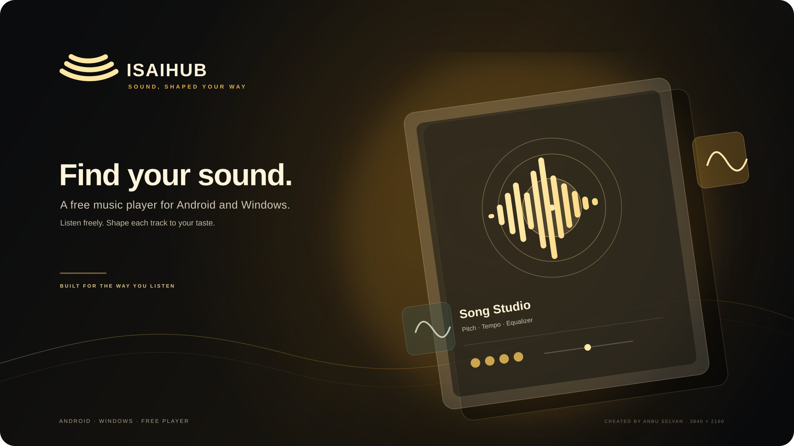
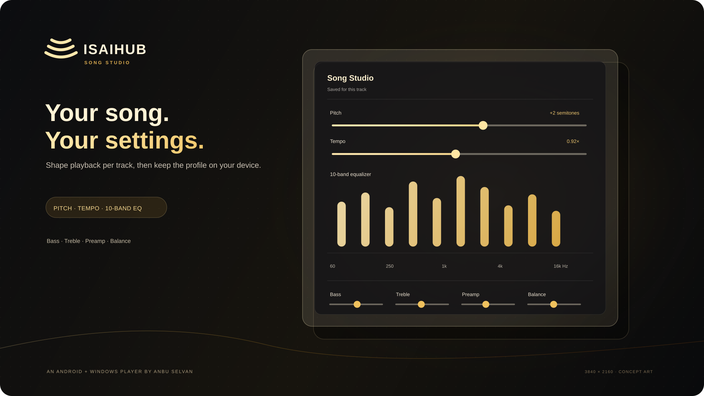

# ISAIHUB

### Music, shaped around the way you listen

**A free music player for Android phones and Windows PCs.**

Created and published by **ANBU SELVAN**.

[Android APK](https://github.com/ANBU-SELVAN-1907/ISAIHUB-Downloads/releases/latest/download/ISAIHUB-1.9.3.apk) · [Windows EXE](https://github.com/ANBU-SELVAN-1907/ISAIHUB-Downloads/releases/latest/download/ISAIHUB.Setup.1.9.3.exe) · [Windows MSI](https://github.com/ANBU-SELVAN-1907/ISAIHUB-Downloads/releases/latest/download/ISAIHUB.1.9.3.msi) · [All releases](https://github.com/ANBU-SELVAN-1907/ISAIHUB-Downloads/releases)

---

## Project overview

ISAIHUB is an independent music player built for Android and Windows. It brings browsing, playback, queue and library controls, lyrics, and personal sound adjustments into one app. The interface is designed to feel at home on a phone or a desktop, with configurable color themes and translucent surfaces.

A central feature is **Song Studio**: open a track’s three-dot menu to adjust how that particular track sounds. Pitch, tempo, equalizer bands, bass, treble, preamp, and left-right balance can be tuned separately and the track’s profile is saved on the device.

This repository is the public project overview and download page. It contains release information and visual assets; it does not include ISAIHUB application source code.

## App artwork

The artwork below is vector-based and rendered at **3840 × 2160 (4K)**. It is promotional concept art illustrating the app’s visual direction and Song Studio controls, not a captured screenshot of a running app.

[Download the 4K overview artwork](assets/isaihub-overview-4k.svg) · [Download the 4K Song Studio artwork](assets/isaihub-song-studio-4k.svg)

## Download ISAIHUB

| Platform | Download | How to install |
| --- | --- | --- |
| Android phone or tablet | [ISAIHUB APK](https://github.com/ANBU-SELVAN-1907/ISAIHUB-Downloads/releases/latest/download/ISAIHUB-1.9.3.apk) | Download, open the APK, and allow installation when Android prompts. |
| Windows PC or laptop | [EXE setup](https://github.com/ANBU-SELVAN-1907/ISAIHUB-Downloads/releases/latest/download/ISAIHUB.Setup.1.9.3.exe) | Run setup and follow the installer. |
| Windows PC or laptop | [MSI installer](https://github.com/ANBU-SELVAN-1907/ISAIHUB-Downloads/releases/latest/download/ISAIHUB.1.9.3.msi) | Open the MSI and follow the installer. |

[Verify release checksums](https://github.com/ANBU-SELVAN-1907/ISAIHUB-Downloads/releases/latest/download/SHA256SUMS.txt) · [Browse every release](https://github.com/ANBU-SELVAN-1907/ISAIHUB-Downloads/releases)

### Android installation and upgrade

ISAIHUB 1.9.3 uses Android application ID com.isaihub.music. Builds with a different application ID are treated as a separate app by Android. If upgrading from one of those builds, export your library/settings backup first, uninstall the old app, install this APK, then restore your backup.

Android may ask you to allow installation from the browser or file manager used to open the APK. The APK is intended for Android 8.0 (API 26) and later.

### Windows installation

Choose either the EXE setup wizard or MSI package. The Windows installers are not code-signed; Windows may display its standard publisher warning before installation.

## What ISAIHUB includes

### Listening and discovery

- In-app browsing and playback for supported music sources.
- Queue and library tools, lyrics where available, and familiar playback controls.
- Responsive layouts for phone, tablet, and desktop-sized screens.
- Desktop media-key support.

### Personal sound with Song Studio

Song Studio is available in the three-dot menu for a track. It offers:

- Independent pitch and playback-speed controls.
- A 10-band equalizer.
- Bass, treble, preamp, and stereo balance controls.
- A separate saved profile for each track, stored locally on the device.
- Gain handling intended to help reduce clipping when several boosts are applied.

Large adjustments can change sound quality or cause distortion; results also depend on the source and playback device.

### Appearance and interaction

- Four selectable accent themes: Champagne, Jade, Iris, and Rose.
- Dark surfaces with translucent layers.
- Compact, responsive controls and restrained motion across phone and desktop layouts.
- A consistent player identity across Android and Windows.

## What makes it useful

ISAIHUB puts per-track sound shaping close to playback, so a listener can tune one song without applying the same equalizer profile to every track. The phone and Windows versions share the same product direction, and the app does not require an ISAIHUB account, subscription, browser extension, or paid unlock for its core experience.

The app is free to download and use. Some third-party providers may have their own account, availability, region, or usage requirements. Those are set by the provider, not by ISAIHUB.

## Clear scope and limitations

- ISAIHUB is a music player and interface; it is not a promise of a licensed or unlimited music catalogue.
- Music availability, audio quality, lyrics, and playback behavior depend on supported sources, network conditions, device support, and the source’s terms.
- ISAIHUB does not own third-party recordings, artwork, or service marks and does not grant rights to copy or redistribute them.
- ISAIHUB is an independent project created and published by **ANBU SELVAN**. It is not affiliated with YouTube, Google, Apple, Spotify, or other music providers.
- The files offered here are installation packages, not an extension or a request to connect an extension.

## Project authorship

**ISAIHUB is created and published by ANBU SELVAN.** This downloads repository is maintained for the project’s public overview and release files. The application source is not distributed from this public repository. Third-party components and any bundled notices remain subject to their respective licenses.

## Release verification

Each release includes a SHA-256 checksum file. After downloading, compare the installer’s SHA-256 hash with the corresponding entry in SHA256SUMS.txt before installing.

---

**ISAIHUB · Created and published by ANBU SELVAN**

[Get the latest Android and Windows downloads](https://github.com/ANBU-SELVAN-1907/ISAIHUB-Downloads/releases/latest)

